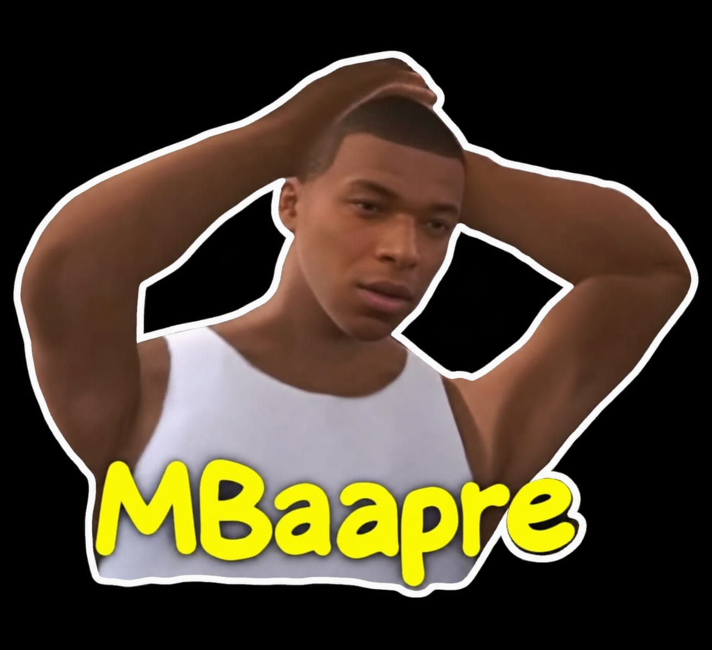

<div align="center">
  
  <h1>The Mbappe Special</h1>
  <p>My skills, the ones I keep borrowing, and how I use them together.</p>
  <p>
    <a href="#get-the-skills">Install</a> &nbsp;·&nbsp;
    <a href="#how-i-use-them">The workflow</a> &nbsp;·&nbsp;
    <a href="#the-collection">The collection</a>
  </p>
</div>

---

I have my own skills, I use a bunch made by other people, and I wanted them in one place with a proper flow. So this is that. Made around how I work in [T3 Code](https://t3.codes), with the important questions asked before I disappear and the agent starts making decisions for me.

## Get the skills

```sh
npx skills add wrestle-R/Mbappe-Special
```

Pick what you want. Each skill works as a separate install too.

```sh
npx skills add wrestle-R/Mbappe-Special --skill half-send
```

Use the skill’s original name after `--skill`, like `grilling`, `unslop` or `frontend-design`.

## How I use them

**grilling → to-spec → to-tickets → half-send**

| Step | What happens |
| :--- | :--- |
| [grilling](skills/mattpocock/grilling/SKILL.md) | Ask the important questions, give me recommended answers, settle the decisions. |
| [to-spec](skills/mattpocock/to-spec/SKILL.md) | Write down what we agreed to build. |
| [to-tickets](skills/mattpocock/to-tickets/SKILL.md) | Split it into complete pieces with clear blockers. |
| [half-send](skills/russel/half-send/SKILL.md) | I approve the work, then the agent gets on with it while I’m away. |

Set up the project’s tracker with [setup-matt-pocock-skills](skills/mattpocock/setup-matt-pocock-skills/SKILL.md) first. Answers carry forward through the steps. A small obvious fix doesn’t need the whole ceremony.

For UI, I pick [taste](skills/leonxlnx/design-taste-frontend/SKILL.md) or [Anthropic frontend-design](skills/anthropic/frontend-design/SKILL.md) for the direction. [Eyes of Render](skills/russel/eyes-of-render/SKILL.md) checks the implementation: the theme, the controls, the resizing, the actual thing on screen.

For bugs, it’s **diagnose → reproduce → fix → prove**, using [diagnosing-bugs](skills/mattpocock/diagnosing-bugs/SKILL.md). Commit verified milestones along the way. Releases and deployments still need their own authorization.

## The collection

| Mine | What it’s for |
| :--- | :--- |
| [half-send](skills/russel/half-send/SKILL.md) | Approved work while I’m away. |
| [eyes-of-render](skills/russel/eyes-of-render/SKILL.md) | The workflow and UI checks I keep asking for. |
| [russelore](skills/russel/russelore/SKILL.md) | Website copy, blogs and other text written as me. |
| [rdp-commit](skills/russel/rdp-commit/SKILL.md) | Short casual commit names. |
| [readme-rdp](skills/russel/readme-rdp/SKILL.md) | A little backstory, a useful visual, the instructions you need. |
| [tagged-release](skills/russel/tagged-release/SKILL.md) | Sol handles the release, Luna waits, Sol handles the result. |

<details>
<summary><strong>The ones I borrow</strong></summary>

<br>

| From | What I keep here |
| :--- | :--- |
| [Matt Pocock](skills/mattpocock/) | Grilling, specs, tickets, tracker setup and bug diagnosis. |
| [pstack](skills/pstack/) | Unslop, sharper prompts, root-cause fixes, practical tests and proof that things work. |
| [Leonxlnx](skills/leonxlnx/) | Taste for frontend art direction and design checks. |
| [Anthropic](skills/anthropic/) | Frontend design. |

Unslop is for the agent’s replies and explanations to me. Russelore is for text written as me. Both have a job here.

Upstream copies keep their original names, instructions and licenses. [The source manifest](upstream-sources.json) records the exact revisions.

</details>

<br>

[Which skills fit where](docs/skill-review.md) · [The full pstack review](docs/pstack-review.md)

Taste’s tooling needs Node 22+ and Chromium. Tagged-release needs a host with model delegation and completion handoffs. Private working notes stay in ignored `local-docs/`.
